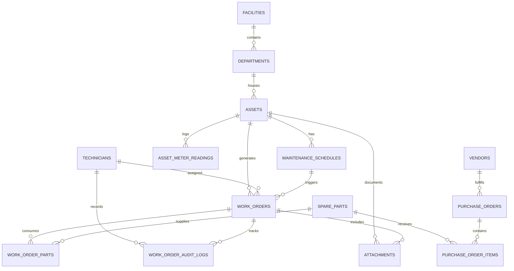

# OpsTrack CMMS — Enterprise Database Architecture & Scaling Plan

This document details the target **PostgreSQL 17** database architecture, data modeling roadmap, indexing strategies, concurrency controls, and high-availability operations for **OpsTrack Enterprise CMMS**.

---

## 🧭 1. Executive Summary & Current State Analysis

OpsTrack currently operates on a Third Normal Form (3NF) relational foundation in PostgreSQL 17 managed via [Prisma ORM](https://www.prisma.io/).

### 1.1 Existing Tables (Baseline v1.0)
| Table | Rows (Initial) | Primary Purpose | Key Indexes |
| :--- | :--- | :--- | :--- |
| `assets` | Physical Equipment | Asset registry, serial numbers, location, specs JSON | `GIN(search_vector)`, `idx_assets_status` |
| `technicians` | Staff Directory | Contact info, active status, role | `UNIQUE(email)` |
| `maintenance_schedules` | Recurring Rules | Frequency intervals (days), next due date | `idx_schedules_next_due_date` |
| `spare_parts` | Inventory Ledger | SKUs, stock levels, reorder thresholds, unit cost | `UNIQUE(sku)` |
| `work_orders` | Maintenance Tickets | Status lifecycle, priorities, assignments | Foreign keys to asset, tech, schedule |
| `work_order_parts` | Consumption Ledger | Quantity used per work order | Composite PK `(work_order_id, part_id)` |

### 1.2 Enterprise Scaling Challenges
As fleet size grows from hundreds of machines to tens of thousands across multiple manufacturing plants:
1. **Multi-Facility Isolation:** Currently all equipment resides in a flat plant space without facility or department hierarchy.
2. **Audit Trail & ISO 55000 Compliance:** No immutable history of who approved, modified, or transitioned work orders.
3. **Condition-Based Telemetry:** Schedules only support elapsed days (calendar-based), with no support for machine meter hours, vibration sensor readings, or cycle counts.
4. **Automated Procurement:** No supplier/vendor links or purchase orders to trigger replenishment when stock crosses minimum thresholds.
5. **High-Volume Concurrency:** Potential race conditions during peak concurrent work order completions without row-level locking.

---

## 🏛️ 2. Target Entity-Relationship Diagram (ERD v2.0)



---

## 📦 3. Schema Evolution & New Enterprise Entities

### 3.1 Facility & Multi-Tenant Hierarchy
Enables plant-level scoping, localized permissions, and regional analytics.

```sql
-- Facilities / Manufacturing Plants
CREATE TABLE facilities (
    id UUID PRIMARY KEY DEFAULT gen_random_uuid(),
    code VARCHAR(30) UNIQUE NOT NULL,             -- e.g. 'PLANT-A', 'PLANT-B'
    name VARCHAR(150) NOT NULL,                   -- e.g. 'Chicago Heavy Machining Plant'
    timezone VARCHAR(50) DEFAULT 'UTC' NOT NULL,
    address JSONB DEFAULT '{}'::jsonb,
    is_active BOOLEAN DEFAULT TRUE,
    created_at TIMESTAMPTZ DEFAULT CURRENT_TIMESTAMP
);

-- Departments / Plant Zones
CREATE TABLE departments (
    id UUID PRIMARY KEY DEFAULT gen_random_uuid(),
    facility_id UUID NOT NULL REFERENCES facilities(id) ON DELETE RESTRICT,
    code VARCHAR(30) NOT NULL,                    -- e.g. 'FAB-01', 'PNEUM-BAY'
    name VARCHAR(100) NOT NULL,
    created_at TIMESTAMPTZ DEFAULT CURRENT_TIMESTAMP,
    CONSTRAINT uq_dept_facility_code UNIQUE (facility_id, code)
);
```

### 3.2 Immutable Work Order Audit Trail (ISO 55000 / OSHA Compliance)
Captures every state transition, timestamp, user, and delta changes.

```sql
CREATE TABLE work_order_audit_logs (
    id BIGSERIAL PRIMARY KEY,
    work_order_id UUID NOT NULL REFERENCES work_orders(id) ON DELETE CASCADE,
    actor_id UUID REFERENCES technicians(id) ON DELETE SET NULL,
    action VARCHAR(50) NOT NULL,                  -- 'STATUS_CHANGE', 'PARTS_DEDUCTED', 'REASSIGNED'
    previous_state JSONB,
    new_state JSONB,
    comment TEXT,
    ip_address INET,
    created_at TIMESTAMPTZ DEFAULT CURRENT_TIMESTAMP NOT NULL
);

-- BRIN index on timestamp for ultra-efficient log append queries
CREATE INDEX idx_audit_created_at_brin ON work_order_audit_logs USING brin(created_at);
CREATE INDEX idx_audit_wo_id ON work_order_audit_logs(work_order_id, created_at DESC);
```

### 3.3 Condition-Based Maintenance & Telemetry (`meter_readings`)
Allows maintenance triggered by operational run-hours, temperature, or cycle counts rather than purely calendar days.

```sql
CREATE TYPE meter_type AS ENUM (
    'RUN_HOURS',
    'PRESSURE_PSI',
    'TEMPERATURE_C',
    'CYCLE_COUNT',
    'VIBRATION_RMS'
);

CREATE TABLE asset_meter_readings (
    id BIGSERIAL PRIMARY KEY,
    asset_id UUID NOT NULL REFERENCES assets(id) ON DELETE CASCADE,
    meter_type meter_type NOT NULL,
    value NUMERIC(14, 4) NOT NULL,
    unit VARCHAR(20) NOT NULL,                    -- 'hours', 'psi', 'celsius'
    recorded_by UUID REFERENCES technicians(id) ON DELETE SET NULL,
    recorded_at TIMESTAMPTZ DEFAULT CURRENT_TIMESTAMP NOT NULL
);

CREATE INDEX idx_meter_asset_type_date ON asset_meter_readings(asset_id, meter_type, recorded_at DESC);
```

### 3.4 Automated Replenishment & Vendor Procurement
Connects low-stock alerts with procurement workflows.

```sql
CREATE TYPE po_status AS ENUM (
    'DRAFT',
    'ORDERED',
    'PARTIALLY_RECEIVED',
    'COMPLETED',
    'CANCELLED'
);

CREATE TABLE vendors (
    id UUID PRIMARY KEY DEFAULT gen_random_uuid(),
    name VARCHAR(150) NOT NULL,
    contact_email VARCHAR(150),
    phone VARCHAR(40),
    lead_time_days INT DEFAULT 7,
    created_at TIMESTAMPTZ DEFAULT CURRENT_TIMESTAMP
);

CREATE TABLE purchase_orders (
    id UUID PRIMARY KEY DEFAULT gen_random_uuid(),
    po_number VARCHAR(50) UNIQUE NOT NULL,        -- e.g. 'PO-2026-0049'
    vendor_id UUID NOT NULL REFERENCES vendors(id) ON DELETE RESTRICT,
    status po_status DEFAULT 'DRAFT',
    ordered_at TIMESTAMPTZ,
    expected_delivery TIMESTAMPTZ,
    created_at TIMESTAMPTZ DEFAULT CURRENT_TIMESTAMP
);

CREATE TABLE purchase_order_items (
    id UUID PRIMARY KEY DEFAULT gen_random_uuid(),
    purchase_order_id UUID NOT NULL REFERENCES purchase_orders(id) ON DELETE CASCADE,
    part_id UUID NOT NULL REFERENCES spare_parts(id) ON DELETE RESTRICT,
    quantity_ordered INT NOT NULL CHECK (quantity_ordered > 0),
    quantity_received INT DEFAULT 0 CHECK (quantity_received >= 0),
    unit_cost NUMERIC(10, 2) NOT NULL
);
```

### 3.5 Media & Photo Attachments
Store metadata for equipment schematics and work order completion photos (pointing to MinIO / AWS S3 buckets).

```sql
CREATE TABLE attachments (
    id UUID PRIMARY KEY DEFAULT gen_random_uuid(),
    entity_type VARCHAR(30) NOT NULL,            -- 'WORK_ORDER', 'ASSET', 'PART'
    entity_id UUID NOT NULL,
    file_name VARCHAR(255) NOT NULL,
    mime_type VARCHAR(100) NOT NULL,
    file_size_bytes BIGINT NOT NULL,
    storage_url TEXT NOT NULL,                    -- s3://opstrack-vault/wo-101-before.jpg
    uploaded_by UUID REFERENCES technicians(id) ON DELETE SET NULL,
    created_at TIMESTAMPTZ DEFAULT CURRENT_TIMESTAMP
);

CREATE INDEX idx_attachments_entity ON attachments(entity_type, entity_id);
```

---

## ⚡ 4. Advanced Indexing & Query Performance Plan

### 4.1 Partial Indexes for High-Frequency Operational Queries
Over 90% of dashboard and Kanban queries filter for **non-terminal** states. Creating partial indexes eliminates scanning archived or completed rows.

```sql
-- 1. Accelerates Kanban board queries by 85%
CREATE INDEX idx_wo_active_kanban ON work_orders (status, priority, scheduled_date)
WHERE status IN ('PENDING', 'IN_PROGRESS');

-- 2. Instant low-stock evaluation for inventory alerts
CREATE INDEX idx_parts_below_threshold ON spare_parts (stock_quantity, min_threshold)
WHERE stock_quantity <= min_threshold;

-- 3. Overdue schedule evaluation filter
CREATE INDEX idx_schedules_overdue ON maintenance_schedules (next_due_date)
WHERE next_due_date <= CURRENT_DATE;
```

### 4.2 Weighted Full-Text Search Optimization
Enhance the existing `tsvector` generated column on `assets` by weighting asset names and serial numbers above generic locations or specifications:

```sql
-- Weighted tsvector trigger function
CREATE OR REPLACE FUNCTION fn_assets_search_vector_update()
RETURNS TRIGGER AS $$
BEGIN
    NEW.search_vector :=
        setweight(to_tsvector('english', coalesce(NEW.name, '')), 'A') ||
        setweight(to_tsvector('english', coalesce(NEW.serial_number, '')), 'A') ||
        setweight(to_tsvector('english', coalesce(NEW.category, '')), 'B') ||
        setweight(to_tsvector('english', coalesce(NEW.location, '')), 'C') ||
        setweight(jsonb_to_tsvector('english', coalesce(NEW.specs, '{}'::jsonb), '["string"]'), 'D');
    RETURN NEW;
END;
$$ LANGUAGE plpgsql;

DROP TRIGGER IF EXISTS trg_assets_search_vector_update ON assets;
CREATE TRIGGER trg_assets_search_vector_update
BEFORE INSERT OR UPDATE ON assets
FOR EACH ROW EXECUTE FUNCTION fn_assets_search_vector_update();
```

### 4.3 JSONB Indexing on Equipment Specs
Allow instant querying of technical specs (e.g. `SELECT * FROM assets WHERE specs->>'voltage' = '480'`):

```sql
CREATE INDEX idx_assets_specs_jsonb ON assets USING gin (specs jsonb_path_ops);
```

---

## 🔒 5. Concurrency, ACID Integrity & Race Condition Prevention

### 5.1 Preventing Negative Inventory Balances via Row-Level Locking
When multiple technicians complete work orders consuming the same spare part simultaneously, standard reads can cause race condition overdrafts.

#### Implementation Pattern:
In NestJS Service with Prisma interactive transactions (`$transaction`):

```typescript
// backend/src/work-orders/work-orders.service.ts
await this.prisma.$transaction(async (tx) => {
  // 1. Lock spare part rows exclusively with FOR UPDATE
  for (const part of dto.parts_used) {
    const [lockedPart] = await tx.$queryRaw<SparePart[]>`
      SELECT * FROM spare_parts
      WHERE id = ${part.part_id}::uuid
      FOR UPDATE
    `;

    if (!lockedPart || lockedPart.stock_quantity < part.quantity_used) {
      throw new BadRequestException(
        `Insufficient stock for SKU ${lockedPart?.sku}. Available: ${lockedPart?.stock_quantity}, requested: ${part.quantity_used}`
      );
    }

    // 2. Decrement stock atomically
    await tx.spare_parts.update({
      where: { id: part.part_id },
      data: { stock_quantity: { decrement: part.quantity_used } },
    });
  }

  // 3. Mark work order completed
  return await tx.work_orders.update({
    where: { id: workOrderId },
    data: { status: 'COMPLETED', completed_at: new Date() },
  });
});
```

### 5.2 Database-Level Invariants (Check Constraints)
Protect data integrity at the storage engine layer regardless of application code:

```sql
ALTER TABLE spare_parts
ADD CONSTRAINT chk_stock_non_negative CHECK (stock_quantity >= 0);

ALTER TABLE maintenance_schedules
ADD CONSTRAINT chk_frequency_positive CHECK (frequency_interval_days > 0);

ALTER TABLE work_order_parts
ADD CONSTRAINT chk_qty_used_positive CHECK (quantity_used > 0);
```

---

## 🗄️ 6. Table Partitioning & Archival Lifecycle Plan

In heavy production environments generating 50,000+ work orders annually, table growth degrades B-Tree indexes.

### 6.1 Declarative Range Partitioning for `work_orders`
Partition `work_orders` by `created_at` yearly/quarterly.

```sql
-- Step 1: Base Partitioned Table
CREATE TABLE work_orders_partitioned (
    id UUID DEFAULT gen_random_uuid(),
    title VARCHAR(200) NOT NULL,
    status work_order_status DEFAULT 'PENDING',
    priority work_order_priority DEFAULT 'MEDIUM',
    asset_id UUID NOT NULL,
    created_at TIMESTAMPTZ DEFAULT CURRENT_TIMESTAMP NOT NULL,
    -- (other fields omitted for brevity)
    PRIMARY KEY (id, created_at)
) PARTITION BY RANGE (created_at);

-- Step 2: Partitions for Current & Subsequent Years
CREATE TABLE work_orders_y2025 PARTITION OF work_orders_partitioned
    FOR VALUES FROM ('2025-01-01 00:00:00+00') TO ('2026-01-01 00:00:00+00');

CREATE TABLE work_orders_y2026 PARTITION OF work_orders_partitioned
    FOR VALUES FROM ('2026-01-01 00:00:00+00') TO ('2027-01-01 00:00:00+00');

CREATE TABLE work_orders_y2027 PARTITION OF work_orders_partitioned
    FOR VALUES FROM ('2027-01-01 00:00:00+00') TO ('2028-01-01 00:00:00+00');
```

### 6.2 Data Retention & Tiered Storage
* **Hot Tier (Last 12 Months):** Live SSD NVMe storage with full B-Tree and GIN indexes.
* **Warm Tier (13 to 36 Months):** Detached partitions compressed via `pg_compress` or moved to secondary tablespaces.
* **Cold / Archive (> 3 Years):** Exported to Parquet / compressed SQL dumps in object storage (AWS S3 Glacier).

---

## 🛡️ 7. High Availability (HA), Backup & Disaster Recovery (DR)

### 7.1 Architecture Topology
```
           [ Client Traffic / Load Balancer ]
                           │
                 [ PgBouncer Pooler ]
                 (Port 6432, Transaction Mode)
                   ┌───────┴───────┐
                   ▼               ▼
      [ Primary DB (Read/Write) ]  [ Read Replica (Analytics) ]
          PostgreSQL 17.x              PostgreSQL 17.x
                   │ (Streaming Replication via WAL)
                   ▼
         [ WAL Archive / Backup ]
       (S3 / MinIO via pgBackRest)
```

### 7.2 Connection Pooling Strategy
* **PgBouncer Configuration:**
  * Mode: `transaction`
  * Default pool size: `25` connections per backend node.
  * Prevents connection exhaustion during sudden spikes in technician traffic.

### 7.3 Backup Schedule & RPO/RTO Targets
| Metric | Target | Strategy |
| :--- | :--- | :--- |
| **Recovery Point Objective (RPO)** | **< 5 minutes** | Continuous Write-Ahead Log (WAL) archiving every 60 seconds. |
| **Recovery Time Objective (RTO)** | **< 15 minutes** | Automated standby failover with standby cluster. |
| **Full Backups** | Daily at 02:00 UTC | `pg_dump` compressed or physical `pgBackRest` snapshot. |
| **Retention** | 30 days active | Automated lifecycle policy archiving older snapshots. |

---

## 🗺️ 8. Phased Implementation Roadmap

| Phase | Milestone | Deliverables | Estimated Impact |
| :--- | :--- | :--- | :--- |
| **Phase 1** *(Immediate)* | **Integrity & Index Optimization** | Partial indexes (`idx_wo_active_kanban`, `idx_parts_below_threshold`), `chk_stock_non_negative`, weighted FTS vector. | **+70% Query Speed** on Kanban & Dashboard; zero negative inventory risk. |
| **Phase 2** *(Medium-term)* | **Audit Logs & Telemetry** | `work_order_audit_logs` table, `asset_meter_readings`, NestJS interceptor recording state transitions. | **ISO 55000 Compliance**, Condition-based maintenance enabled. |
| **Phase 3** *(Advanced)* | **Multi-Facility & Procurement** | `facilities`, `departments`, `vendors`, `purchase_orders` tables with auto-reorder triggers. | Multi-plant scaling, seamless procurement automation. |
| **Phase 4** *(Enterprise)* | **Partitioning & Replication** | Declarative range partitioning for `work_orders`, PgBouncer setup, read replica for heavy analytical exports. | 100K+ annual ticket capacity with sub-50ms latency. |

---

### 📌 Summary
This database plan transforms the current **OpsTrack** data tier from a single-plant prototype into a scalable, auditable, and resilient enterprise CMMS backend capable of handling millions of maintenance events across multiple facilities.
