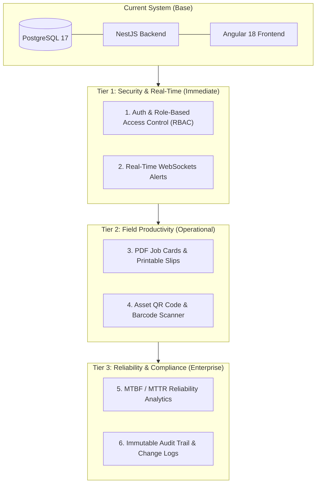
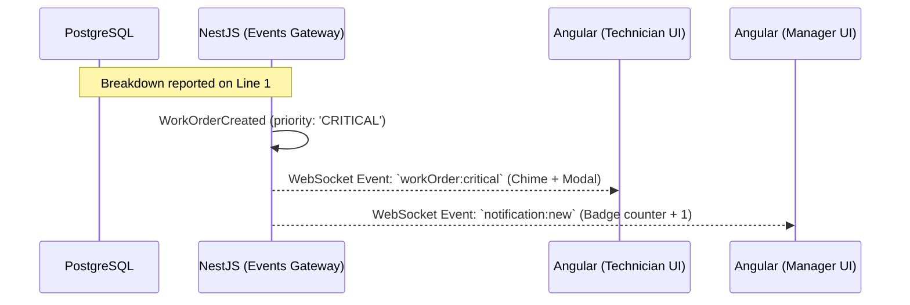
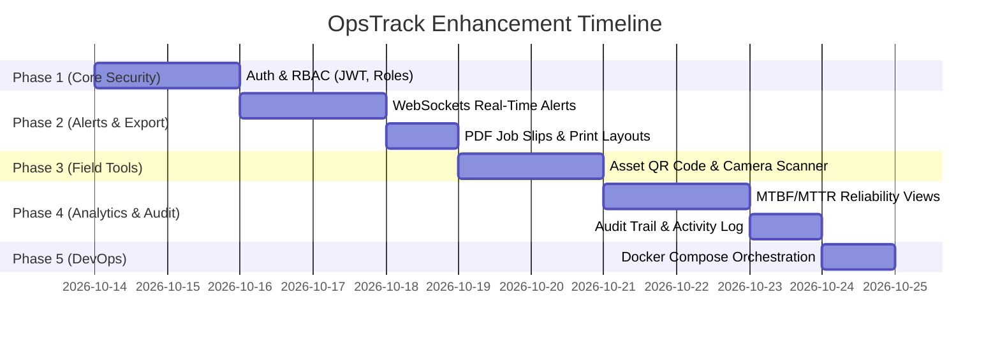

# OpsTrack CMMS — Enterprise Enhancement Plan

> **Document Version:** 1.0  
> **Status:** Roadmap Proposal  
> **Target System:** OpsTrack Industrial Maintenance Management System  
> **Tech Stack:** Angular 18+ (Signals, Tailwind), NestJS 10+ (Prisma ORM), PostgreSQL 17  

---

## 1. Executive Summary & Architecture Roadmap

With the foundational CRUD capabilities, responsive Dark/Light UI, PostgreSQL relational schema, GIN search, and maintenance calendar in place, OpsTrack is ready to evolve from an administrative prototype into a **production-ready industrial maintenance management platform**.

This enhancement plan outlines 6 high-impact modules categorized by priority, business value, and technical complexity.



---

## 2. Enhancement Priority Matrix

| # | Enhancement Feature | Business Value | Tech Complexity | Recommended Order | Key Technologies |
|---|---------------------|----------------|-----------------|-------------------|------------------|
| **1** | **Role-Based Access Control (RBAC) & Auth** | 🔴 Critical | Medium | **Phase 1** | JWT, Passport, Bcrypt, Angular Guards |
| **2** | **Real-Time Push Notifications (WebSockets)** | 🔴 High | Medium | **Phase 2** | NestJS Gateways, Socket.io, Web Audio |
| **3** | **PDF Job Slips & Maintenance Reports** | 🟡 High | Low-Medium | **Phase 3** | PDFKit / pdfmake, Print stylesheets |
| **4** | **QR / Barcode Scanning for Equipment & Bins** | 🟡 High | Medium | **Phase 4** | HTML5 Camera API, `html5-qrcode`, SVG QR |
| **5** | **Reliability Analytics (MTBF / MTTR / OEE)** | 🟢 High | Medium | **Phase 5** | PostgreSQL Analytical Views, Chart.js / SVG |
| **6** | **Audit Trail & System Activity History** | 🟢 Medium | Low | **Phase 6** | PostgreSQL Triggers, Prisma Middleware |
| **7** | **Single-Command Docker Orchestration** | 🟢 Essential | Low | **Phase 7** | `docker-compose.yml`, multi-stage builds |

---

## 3. Deep-Dive Specification by Enhancement

### Module 1: Authentication & Role-Based Access Control (RBAC)

#### 1.1 Why It Matters
In industrial plants, safety and compliance require strict segregation of duties:
* **Technicians** must only view their assigned work orders, log hours, and mark tasks completed.
* **Maintenance Supervisors / Managers** approve high-cost repair orders, schedule PMs, and manage stock.
* **Admins** manage user accounts, permissions, and system configurations.

#### 1.2 Data Model Changes (`users` & `roles`)
```sql
CREATE TYPE user_role AS ENUM ('ADMIN', 'MANAGER', 'TECHNICIAN', 'VIEWER');

CREATE TABLE users (
    id SERIAL PRIMARY KEY,
    email VARCHAR(150) UNIQUE NOT NULL,
    password_hash VARCHAR(255) NOT NULL,
    full_name VARCHAR(120) NOT NULL,
    role user_role NOT NULL DEFAULT 'TECHNICIAN',
    technician_id INT UNIQUE REFERENCES technicians(id) ON DELETE SET NULL,
    is_active BOOLEAN NOT NULL DEFAULT TRUE,
    created_at TIMESTAMP WITH TIME ZONE DEFAULT CURRENT_TIMESTAMP,
    last_login_at TIMESTAMP WITH TIME ZONE
);

CREATE INDEX idx_users_email ON users(email);
```

#### 1.3 Architecture & Implementation
* **Backend (`backend/src/auth`)**:
  * `auth.service.ts`: Secure hashing with `bcrypt` (salt rounds: 12), token issuance with `@nestjs/jwt`.
  * `jwt.strategy.ts`: Validates bearer tokens on all `/api/*` endpoints.
  * `@Roles('ADMIN', 'MANAGER')`: Custom metadata decorator.
  * `roles.guard.ts`: Enforces role-based endpoint permissions.
* **Frontend (`frontend/src/app/core/auth`)**:
  * `AuthService`: Signal-based user state (`currentUser = signal<User | null>(null)`).
  * `AuthGuard`: Redirects unauthenticated users to `/login`.
  * `RoleDirective` (`*hasRole="['ADMIN', 'MANAGER']"`): Automatically hides/disables UI buttons (e.g., Delete Asset, Approve PO).

---

### Module 2: Real-Time Alerts & Notification Engine (WebSockets)

#### 2.1 Why It Matters
When an assembly line motor overheats or an emergency shutdown occurs, waiting for a user to refresh the page can cost thousands of dollars per minute in downtime.
* Immediate toast banner on screen.
* Audio chime alert for `CRITICAL` or `HIGH` severity breakdowns.
* Low spare parts alerts when stock drops below `reorder_level`.

#### 2.2 Architecture & Flow


#### 2.3 Implementation Details
* **Backend (`backend/src/notifications`)**:
  * Implement `EventsGateway` using `@nestjs/websockets` and `socket.io`.
  * Emit events upon lifecycle triggers: `WORK_ORDER_CREATED`, `STATUS_CHANGED`, `LOW_STOCK_WARNING`.
* **Frontend (`frontend/src/app/core/services/notification.service.ts`)**:
  * Top navigation notification bell with badge counter.
  * Slide-out notification drawer with read/unread statuses.
  * Toast notification integration with actionable links (e.g., "Click to open WO-2026-089").

---

### Module 3: PDF Job Cards & Printable Work Order Slips

#### 3.1 Why It Matters
Field technicians often carry physical or tablet-friendly job cards into areas with poor Wi-Fi or hazardous conditions (ATEX zones).

#### 3.2 Output Deliverables
1. **Technician Job Card (Single Work Order)**:
   * Equipment Tag, Location, Criticality.
   * Safety Warnings (Lockout/Tagout - LOTO requirements).
   * Step-by-step task checklist with signature sign-off box.
   * Bill of Materials (required spare parts & quantities).
2. **Monthly Preventive Maintenance Compliance Report**:
   * Summary of completed vs. overdue PM schedules.
   * Total maintenance labor hours and downtime incurred.

#### 3.3 Implementation Plan
* Provide a clean `@media print` CSS stylesheet so any work order detail page can be printed directly via `Ctrl+P`.
* Add backend PDF rendering endpoint `GET /api/work-orders/:id/pdf` using `pdfmake` for standardized high-resolution PDF downloads with company header and QR code.

---

### Module 4: Asset QR Code & Barcode Scanning System

#### 4.1 Why It Matters
Eliminate human typing errors in the plant:
* A technician points their phone camera or barcode gun at equipment `AST-ENG-001`.
* The OpsTrack web app instantly navigates to `/assets/AST-ENG-001`.
* Allows 1-click creation of a corrective work order on the spot.

#### 4.2 Implementation
* **Asset Label Generation**:
  * Generate high-contrast SVG QR codes encoding `https://opstrack.internal/assets/:assetTag`.
  * Dedicated "Print Asset Tag" modal in Angular with standard 2" x 1" thermal label layout.
* **In-Browser Scanner**:
  * Lightweight camera scanner using `html5-qrcode` library.
  * Modal drawer accessible from mobile bottom navigation bar.
  * Instant fallback to manual tag search if camera permission is denied.

---

### Module 5: Industrial Reliability Analytics (MTBF / MTTR / Availability)

#### 5.1 The 3 Essential Maintenance KPIs
1. **MTBF (Mean Time Between Failures)**:
   $$\text{MTBF} = \frac{\text{Total Operating Hours}}{\text{Number of Corrective Breakdowns}}$$
   *Measures equipment reliability and durability.*
2. **MTTR (Mean Time To Repair)**:
   $$\text{MTTR} = \frac{\text{Total Downtime Spent on Repairs}}{\text{Number of Repairs}}$$
   *Measures maintenance team efficiency and response speed.*
3. **Availability (%)**:
   $$\text{Availability} = \frac{\text{MTBF}}{\text{MTBF} + \text{MTTR}} \times 100\%$$

#### 5.2 SQL Analytical View in PostgreSQL
```sql
CREATE OR REPLACE VIEW v_asset_reliability_metrics AS
SELECT 
    a.id AS asset_id,
    a.asset_tag,
    a.name AS asset_name,
    a.category,
    COUNT(wo.id) FILTER (WHERE wo.type = 'CORRECTIVE') AS failure_count,
    COALESCE(SUM(wo.actual_hours) FILTER (WHERE wo.type = 'CORRECTIVE'), 0) AS total_repair_hours,
    ROUND(
        CASE 
            WHEN COUNT(wo.id) FILTER (WHERE wo.type = 'CORRECTIVE') > 0 
            THEN SUM(wo.actual_hours) FILTER (WHERE wo.type = 'CORRECTIVE')::numeric / COUNT(wo.id) FILTER (WHERE wo.type = 'CORRECTIVE')
            ELSE 0 
        END, 2
    ) AS mttr_hours
FROM assets a
LEFT JOIN work_orders wo ON a.id = wo.asset_id AND wo.status = 'COMPLETED'
GROUP BY a.id, a.asset_tag, a.name, a.category;
```

#### 5.3 UI Dashboard Widget
* Add dedicated **Reliability Tab** on the Dashboard with:
  * Top 5 "Bad Actor" assets (highest failure frequency).
  * MTTR trend lines comparing this month vs. previous quarter.
  * Department downtime heat map.

---

### Module 6: Immutable Audit Trail & Change History

#### 6.1 Why It Matters
Required for ISO 55001 (Asset Management) and ISO 9001 audits. Provides a complete forensic history:
* *Who* approved the work order?
* *When* was the asset status changed from `OPERATIONAL` to `DOWN`?
* *How many* bearings were withdrawn from stock and by whom?

#### 6.2 Data Model
```sql
CREATE TABLE audit_logs (
    id BIGSERIAL PRIMARY KEY,
    entity_name VARCHAR(50) NOT NULL, -- 'work_orders', 'assets', 'spare_parts'
    entity_id INT NOT NULL,
    action VARCHAR(20) NOT NULL,      -- 'CREATE', 'UPDATE', 'STATUS_CHANGE', 'DELETE'
    changed_by VARCHAR(120),
    old_values JSONB,
    new_values JSONB,
    created_at TIMESTAMP WITH TIME ZONE DEFAULT CURRENT_TIMESTAMP
);

CREATE INDEX idx_audit_logs_entity ON audit_logs(entity_name, entity_id);
CREATE INDEX idx_audit_logs_created_at ON audit_logs(created_at DESC);
```

#### 6.3 UI History Timeline
* Expand the Work Order and Asset detail pages with an **Activity & History** vertical timeline showing all state transitions and timestamps.

---

### Module 7: Production Containerization (`docker-compose`)

#### 7.1 Multi-Stage Architecture
* **`frontend/Dockerfile`**: Build Angular with Node 20, serve compiled static assets with ultra-light `nginx:alpine`.
* **`backend/Dockerfile`**: Build NestJS TypeScript, run production Node 20 image with Prisma client.
* **`docker-compose.yml`**:
  * Service `postgres`: PostgreSQL 17 with healthcheck and persistent volume.
  * Service `backend`: Depends on postgres healthcheck; runs Prisma migrations on startup.
  * Service `frontend`: Exposes port 80/443 with Nginx reverse proxy routing `/api` to backend.

---

## 4. Suggested Execution Schedule



---

## 5. Next Decision: Where Should We Start?

When you are ready to implement the next enhancement, we can begin with any of these:

1. **Option A (Recommended First): Role-Based Access Control (RBAC)**  
   *Add Login, JWT tokens, and Admin / Manager / Technician roles.*
2. **Option B: Real-Time Alerts & WebSockets**  
   *Add live popups and audio chimes when high-priority breakdowns are created.*
3. **Option C: Printable Job Cards & PDF Export**  
   *Generate downloadable, printable work order slips for technicians.*
4. **Option D: QR Code Tag Generator & Scanner**  
   *Generate equipment tags and scan them with a camera.*

*(No code will be modified until you confirm which enhancement you would like to proceed with.)*
